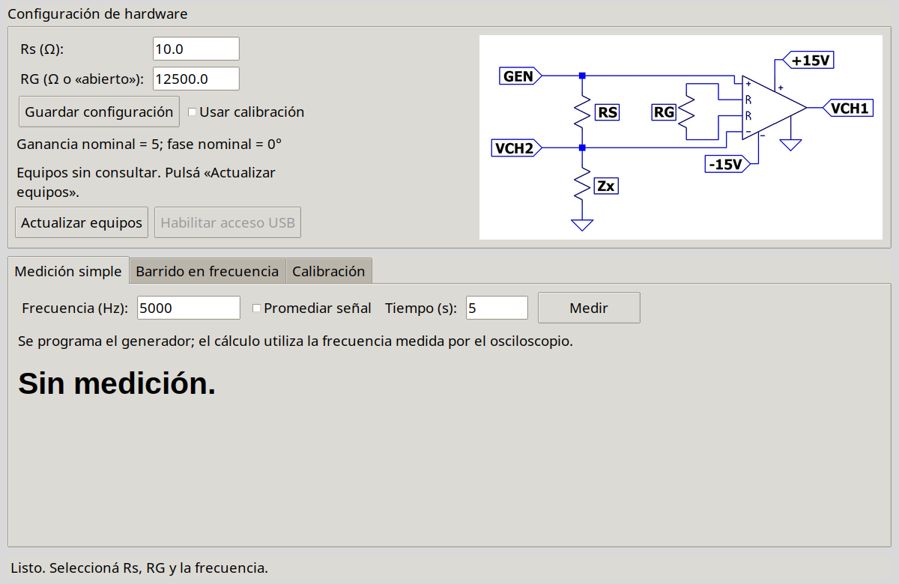
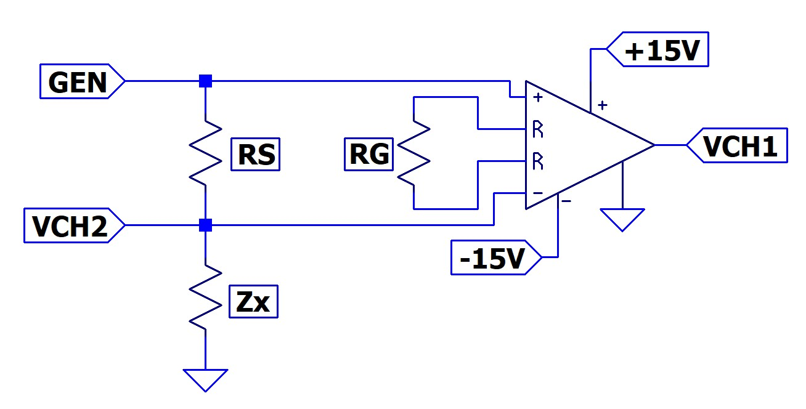

# Analizador de Impedancias LC Complejas

**Versión final del proyecto — código principal en la rama `main`.**

## Descargar la versión final

**[Descargar la versión final en ZIP](https://github.com/NicoGalie/Proyecto-MEII/raw/refs/heads/main/descargas/Analizador_Impedancias_LC_Complejas_FINAL.zip)**

El ZIP contiene el código Python, recursos, documentación y pruebas de esta
versión. No incluye el entorno virtual ni calibraciones de una computadora
particular. Se instala siguiendo las instrucciones de abajo.

El [programa original](original/) se conserva por separado y sin modificar.
La rama [`Lucas`](https://github.com/NicoGalie/Proyecto-MEII/tree/Lucas) conserva
su contenido anterior. Para usar la versión final, descargá el ZIP anterior o
cloná `main`:

```bash
git clone --branch main https://github.com/NicoGalie/Proyecto-MEII.git
cd Proyecto-MEII
```



## Qué hace el programa

Aplicación de escritorio en Python/Tkinter que controla un generador y un
osciloscopio por USB para obtener la impedancia compleja de un componente.
Ofrece medición a una frecuencia, barrido lineal, calibración con una resistencia
conocida y compensación opcional del residual de circuito abierto.

Muestra tensión RMS de cada canal, frecuencia medida, corriente, módulo y fase
de la impedancia, resistencia serie equivalente (ESR), reactancia, inductancia o
capacitancia serie y factor Q o D. La imagen del circuito se ajusta al panel
superior y se amplía al hacer clic. El ícono tiene fondo blanco.

## Instalación y ejecución

La plataforma documentada es **Linux, con Python 3.12 y una sesión gráfica**.
Tkinter y la biblioteca del sistema libusb deben estar instalados. En
Debian/Ubuntu/Linux Mint:

```bash
sudo apt install python3 python3-venv python3-tk libusb-1.0-0
python3 -m venv .venv
.venv/bin/python -m pip install -r requirements.txt
bash iniciar.sh
```

Ejecutá los comandos dentro de la carpeta del proyecto descomprimido o clonado.
El lanzador usa rutas relativas a su propia ubicación y el intérprete de `.venv`.
No es necesario ejecutar la aplicación como administrador.

Las dependencias Python están fijadas en [requirements.txt](requirements.txt):
NumPy para el procesamiento numérico; PyVISA y PyVISA-py para la comunicación;
PyUSB/libusb para USB; Pillow para redimensionar el esquema sin deformarlo;
PySerial, psutil y zeroconf para los recursos del backend VISA.

### Acceso directo con ícono blanco

Después de instalar el entorno, ejecutá:

```bash
python3 linux/instalar_acceso.py
```

El instalador crea **Analizador de Impedancias LC Complejas** en el escritorio,
con las rutas de tu computadora y el ícono `recursos/utn-fondo-blanco.png`.
La carpeta del proyecto debe permanecer en esa ubicación; si la movés, volvé a
ejecutar el instalador. No necesita permisos de administrador. Si el escritorio
solicita permitir la ejecución del lanzador, habilitala.

También podés elegir una carpeta de destino:

```bash
python3 linux/instalar_acceso.py --destino /ruta/al/escritorio
```

### Instrumentos y permisos USB

El código reconoce osciloscopios **Tektronix TBS2072B, TBS2074B, TBS2102B,
TBS2104B, TBS2202B y TBS2204B**, y equipos **UNI-T/UNI-TREND DSO o UTD**.
El generador se identifica por `UTG` en su respuesta a `*IDN?` y se controla con
el comando de frecuencia de esa familia. Esto describe los protocolos
implementados; cada combinación física requiere comprobar sus respuestas SCPI.

Conectá un solo osciloscopio y un solo generador. Pulsá **Actualizar equipos**.
Si falta acceso, **Habilitar acceso USB** solicita autorización de Linux para
instalar reglas udev únicamente para los instrumentos USBTMC seleccionados y
conectados. Después, actualizá la lista nuevamente. Esa función requiere
`pkexec`, `udevadm` y el entorno de permisos de Linux.

La detección es manual: abrir la aplicación no inicia comunicaciones con los
equipos. El promedio ajustable y el tratamiento de capturas están implementados
para los Tektronix indicados; UNI-T utiliza consultas automáticas de medida.

## Circuito y significado de los parámetros



La conexión de medida es `GEN → Rs → Zx → masa`. El amplificador diferencial
mide la caída sobre Rs: su entrada positiva va al lado del generador y la
negativa al nodo entre Rs y Zx. La referencia del amplificador y las masas de
las sondas se conectan a masa, según el esquema.

| Símbolo | Significado en el programa |
|---|---|
| `Rs` | Resistencia sensora real, en ohmios, en serie con el componente |
| `RG` | Resistencia física que determina la ganancia nominal del amplificador |
| `Zx` | Impedancia desconocida conectada al circuito |
| `Vo` / CH1 | Salida del amplificador: caída en Rs amplificada |
| `VZ` / CH2 | Tensión sobre Zx |
| `f` | Frecuencia medida de la señal, en Hz |
| `φ` | Fase de CH2 respecto de CH1, en grados |

Ingresá los valores de Rs y RG realmente instalados. Se admite coma decimal.
`RG = abierto` representa la ausencia de resistencia y ganancia nominal 1.
**Guardar configuración** conserva esos parámetros; cambiar un campo no cambia
físicamente el circuito. Los valores iniciales son Rs = 10 Ω y RG = 12.500 Ω.

## Modelo matemático

### Cálculo nominal

La implementación de [configuracion.py](Codigo/configuracion.py) usa:

$$G_{nom}=1+\frac{50\,000}{R_G}$$

Para RG abierta se utiliza directamente $G_{nom}=1$. Con RG = 12.500 Ω, G = 5.
En [calculos.py](Codigo/calculos.py), sin calibración aplicable:

$$I=\frac{V_o}{G_{nom}R_s},\qquad |Z_x|=\frac{V_Z}{I}$$

$$Z_x=|Z_x|\left(\cos\varphi+j\sin\varphi\right)=R_{serie}+jX_s$$

La conexión es no inversora: no se añade una corrección de 180°. La frecuencia
usada para obtener L o C es la medida, no la frecuencia solicitada al generador.

| Condición | Identificación y resultado |
|---|---|
| $X_s>0$ | Inductor: $L=X_s/(2\pi f)$; $Q=X_s/R_{serie}$ |
| $X_s<0$ | Capacitor: $C=-1/(2\pi fX_s)$; $D=R_{serie}/|X_s|$ |
| $X_s=0$ | Resistencia: $R=R_{serie}$ |

Son parámetros de un **equivalente serie** a la frecuencia medida. En el caso
inductivo con resistencia serie cero, Q se presenta como infinito. El programa
rechaza resultados no finitos, señales inválidas y ESR negativa; no convierte
un resultado inválido en cero ni fuerza un componente válido.

### Calibración con resistencia conocida

Se reemplaza Zx por una resistencia de referencia $R_{ref}$ y se adquieren
amplitud y fase en un conjunto de frecuencias. Cada punto obtiene:

$$G_{cal}(f)=\frac{V_{o,ref}\,R_{ref}}{V_{Z,ref}\,R_s},
\qquad \varphi_{cal}(f)=\varphi_{ref}$$

Al medir un componente, se reemplaza la ganancia nominal por $G_{cal}(f)$ y se
utiliza $\varphi-\varphi_{cal}(f)$. La ganancia se interpola linealmente entre
frecuencias medidas; la fase se interpola considerando su normalización a
$[-180^\circ,180^\circ)$.

RG determina la ganancia nominal y también identifica la configuración física
del perfil. **Cuando la calibración se aplica, se utilizan los valores medidos
en ella, no la ganancia nominal calculada con RG.**

Para calibrar: ingresá Rs y RG, colocá la resistencia conocida, completá su
valor y el barrido en **Calibración**, y pulsá **Calibrar con resistencia**.
La referencia debe comportarse como una resistencia en todo ese rango.
El perfil se guarda únicamente si la calibración completa es válida; ante
un error o cancelación se conserva el perfil anterior.

### Compensación opcional de circuito abierto

El perfil versión 2 añade un residual complejo. Se define la relación:

$$m=\frac{V_o}{V_Z}e^{-j\varphi}=\frac{A}{Z_x}+h$$

El abierto permite obtener $h$ y la resistencia conocida determina:

$$A=R_{ref}(m_{ref}-h),\qquad Z_x=\frac{A}{m-h}$$

Primero se mide el abierto y después la resistencia manteniendo Rs, RG, equipo,
método y frecuencias. Se requieren tres capturas coherentes por punto: el
residual debe ser medible y sus fasores deben diferir del promedio como máximo
un 1 % de su módulo. La señal de referencia debe distinguirse de ese residual.
El abierto no sirve para asignar una fase confiable a ruido de corriente nula.

### Cuándo se aplica el perfil

| Situación | Modelo utilizado |
|---|---|
| «Usar calibración» desmarcado o sin perfil guardado | Nominal |
| Perfil válido, misma Rs/RG, mismo osciloscopio y método, frecuencia cubierta | Calibrado |
| Otra Rs, RG, identidad del osciloscopio o método | Nominal completo |
| Frecuencia solicitada o medida fuera del rango cubierto | Nominal completo |

La identidad incluye fabricante, modelo y número de serie. En los extremos se
tolera un desvío de reloj del 0,1 % en la frecuencia medida, si la frecuencia
solicitada pertenece al rango. No se extrapola la calibración. Si se utiliza el
modelo nominal se descartan también la corrección de fase y el residual.
Un perfil mal formado produce un error de validación. La interfaz y las filas
del barrido muestran el ajuste utilizado y su motivo.

## Adquisición y procesamiento de señal

Una medición sigue este recorrido:

```text
Botón Medir → validar campos → iniciar trabajador
  → abrir sesión VISA e identificar instrumentos
  → programar frecuencia → esperar 0,5 s → Autoset → esperar 3 s
  → adquirir CH1/CH2 → elegir ajuste nominal o calibrado
  → calcular Zx, ESR, Xs, L/C y Q/D → mostrar resultado → cerrar recursos
```

Para Tektronix se congelan ambos canales en una misma adquisición, se descargan
las formas de onda con `CURVe?` y se convierten los códigos del ADC usando el
preámbulo de cada canal. Se verifica que compartan el eje de tiempo y no haya
transferencias truncadas ni recorte.

[analisis_senoidal.py](Codigo/analisis_senoidal.py) ajusta por mínimos cuadrados
el modelo `y(t) = a·sin(2πft) + b·cos(2πft) + c`. Refina la frecuencia sobre CH2
en ±5 % de su lectura inicial mediante búsqueda de sección áurea, y ajusta
ambos canales a esa frecuencia común. Obtiene la amplitud RMS de la fundamental
como $\sqrt{a^2+b^2}/\sqrt{2}$ y la fase con `atan2(b, a)`.

Se exigen al menos 100 muestras, 2,5 ciclos, 20 muestras por ciclo y muestreo
uniforme. En medición normal el RMS del residuo del ajuste no puede superar el
5 % del RMS de la fundamental. Ese residuo incluye ruido y componentes que el
modelo senoidal no explica; no constituye una medida separada de THD.

El promedio básico Tektronix usa 16 adquisiciones; en abierto, 128. La opción
**Promediar señal** permite una ventana de 0,5 a 120 s, configura 512 promedios
y verifica al menos dos adquisiciones nuevas. Después de 512, la adquisición
continúa con el promedio nativo del instrumento. Las medidas UNI-T provienen
de sus consultas SCPI de RMS, frecuencia y fase, sin ese ajuste de formas de onda.

## Barrido, tareas y cancelación

El barrido distribuye linealmente al menos dos puntos entre inicio y final,
incluyendo ambos extremos. Cada punto admite **cuatro intentos completos**:
un intento inicial y hasta tres reintentos. La frecuencia medida debe coincidir
con la solicitada dentro de un 5 %. Si falla también el cálculo, el reintento
adquiere una lectura nueva.

Los errores individuales se muestran como `ERROR` y el barrido continúa; la
cancelación produce `CANCELADO` y conserva las filas terminadas. La tabla copia
encabezados y datos separados por tabulaciones para pegarlos en una planilla.
El generador queda en la última frecuencia programada.

[interfaz/tareas.py](Codigo/interfaz/tareas.py) ejecuta una única tarea de
instrumentación en un `Thread`. Una `Queue` transporta progreso y resultado al
hilo de Tk, que la consulta con `after(50, ...)` solo mientras hay trabajo.
Los controles quedan bloqueados para evitar operaciones simultáneas.

La cancelación usa `threading.Event`: interrumpe esperas, pero respeta la
finalización o timeout de un comando VISA en curso. Los recursos VISA se cierran
en `finally`. El controlador Tektronix intenta restaurar los ajustes que guardó
para la adquisición; esto no equivale a restaurar todos los cambios de Autoset,
de escalas o de configuración horizontal.

## Organización del código

| Archivo o carpeta | Responsabilidad |
|---|---|
| [Codigo/Interfaz.py](Codigo/Interfaz.py) | Punto de entrada; no abre ventanas al importarlo |
| [Codigo/configuracion.py](Codigo/configuracion.py) | Rs, RG, ganancia nominal y configuración persistente |
| [Codigo/modelos.py](Codigo/modelos.py) | Dataclasses de lectura, ajuste, medición y resultados |
| [Codigo/calculos.py](Codigo/calculos.py) | Impedancia compleja y equivalente serie |
| [Codigo/calibracion.py](Codigo/calibracion.py) | Creación, validación, selección e interpolación del perfil |
| [Codigo/operaciones.py](Codigo/operaciones.py) | Medición, barrido, calibración y reintentos |
| [Codigo/instrumentos.py](Codigo/instrumentos.py) | Sesión VISA y coordinación del generador/osciloscopio |
| [Codigo/osciloscopios.py](Codigo/osciloscopios.py) | Protocolos SCPI y adquisición por familia |
| [Codigo/analisis_senoidal.py](Codigo/analisis_senoidal.py) | Ajuste numérico de las capturas |
| [Codigo/instrumentos_usb.py](Codigo/instrumentos_usb.py) | Enumeración USB y solicitud de permisos |
| [Codigo/cancelacion.py](Codigo/cancelacion.py) | Cancelación cooperativa |
| [Codigo/persistencia.py](Codigo/persistencia.py) | Lectura JSON y escritura atómica |
| [Codigo/interfaz/](Codigo/interfaz/) | Ventana, paneles, tablas y trabajador |
| [linux/](linux/) | Reglas USB y creación del acceso directo |
| [recursos/](recursos/) | Esquema e íconos |
| [tests/](tests/) | Pruebas numéricas, SCPI simulado y widgets reales Tk |
| [ejemplos/](ejemplos/) | Ejemplo numérico sin instrumentos |
| [docs/](docs/) | Vista previa y guía detallada de lectura del código |
| [original/](original/) | Código inicial conservado; separado de la aplicación final |
| [descargas/](descargas/) | Paquete descargable de la versión final y suma SHA-256 |

## Datos persistentes

Los archivos se crean dentro de `datos/`, relativo al proyecto:

- `circuito-ina128p.json`: Rs y RG guardadas.
- `calibracion-ina128p.json`: perfil de calibración, compatible con versiones 1 y 2.

Los identificadores internos mantienen esos nombres por compatibilidad con el
formato existente. `datos/` está excluida de Git: cada montaje debe generar su
propia calibración. La escritura usa un archivo temporal en la misma carpeta y
`os.replace`, para reemplazar el perfil de forma atómica. Una calibración
cancelada o inválida no sobrescribe el archivo anterior. Al abrir, la aplicación
puede cargar el perfil guardado, pero «Usar calibración» comienza desmarcado.

## Pruebas y ejemplo sin instrumentos

Desde la raíz, con el entorno instalado:

```bash
PYTHONPATH=Codigo:tests .venv/bin/python -m unittest discover -s tests -v
.venv/bin/python ejemplos/medicion_paso_a_paso.py
```

Las pruebas de interfaz necesitan una sesión gráfica. En Linux sin pantalla
se pueden ejecutar bajo Xvfb, si está instalado:

```bash
xvfb-run -a env PYTHONPATH=Codigo:tests .venv/bin/python -m unittest discover -s tests -v
```

La suite contiene **44 pruebas**, con lecturas e instrumentos simulados. Cubre
R/L/C, calibración con y sin residual, interpolación, descarte del perfil,
adquisición senoidal, frecuencia, reintentos, cancelación, persistencia, permisos
USB e interfaz. No sustituye la verificación metrológica con instrumentos y
componentes físicos. La [guía paso a paso](docs/GUIA_PASO_A_PASO.md) desarrolla
el recorrido del código para su estudio y presentación.

## Conservación del original y actualización de la descarga

`original/Codigo/` conserva los archivos del `main` inicial, commit
`03d21e88dad6539eeab2453c20b19680413ed4e5`. Sus contenidos no se mezclan con
`Codigo/`, que corresponde a la versión final. El historial anterior y la rama
`Lucas` se mantienen disponibles.

Para regenerar el ZIP después de un cambio deliberado en la versión final:

```bash
python3 herramientas/empaquetar_final.py
```

El empaquetador incluye solo la aplicación final, sus recursos, pruebas y
documentación; excluye `original/`, `.git`, `.venv`, cachés y datos de usuario.
También actualiza `descargas/SHA256SUMS`. La descarga corresponde al código de
esta rama; debe regenerarse antes de publicar una nueva revisión.
